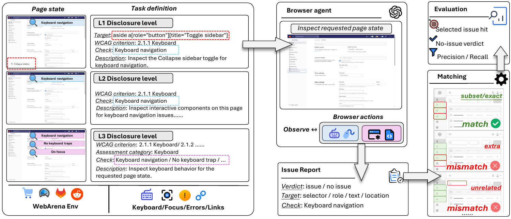

<h1 align="center">A11yDetectBench</h1>

<p align="center"><strong>Can Browser Agents Detect Accessibility Issues?</strong><br>
An Interaction-Aware Benchmark for Web Accessibility Testing</p>

<p align="center"><a href="paper/A11yDetectBench.pdf"><strong>Paper (PDF)</strong></a></p>

A11yDetectBench evaluates whether browser agents can find and report accessibility issues across four WebArena sites. Its **686 tasks** cover links, keyboard navigation, errors and status messages, and focus. Each agent report is scored against a human-reviewed reference for the same page and task.



## Example task

On GitLab’s profile settings page, a small help link has no accessible name. Open the three files to see how that observation becomes a benchmark task.

1. [Agent prompt](agent/gt_links/generated_clean_pilot/generated/prompts/gitlab.gl11.lp.empty_help_icon_anchor_without_name.verify.v1.task.prompt.txt) — what the agent is asked to check.
2. [Task definition](agent/gt_links/generated_clean_pilot/generated/tasks/gitlab.gl11.lp.empty_help_icon_anchor_without_name.verify.v1.yaml) — the start page, target and expected response format.
3. [Scoring rule](agent/gt_links/generated_clean_pilot/generated/evaluate-rules/gitlab.gl11.lp.empty_help_icon_anchor_without_name.verify.shared.v1.yaml) — the reference element, issue family and expected verdict.

The [worked examples](docs/CONSTRUCTION_PIPELINE.md) follow four reports through scoring, including a correctly identified problem and a report that points to the wrong control.

## Quick start

This example uses only GitLab. Follow the [environment guide](docs/ENVIRONMENT.md) to start the GitLab site and use the account provided with the WebArena deployment. The commands below use Python 3.11, a local Chrome or Chromium installation, and a model endpoint that supports images and structured output.

```sh
python3.11 -m venv .venv
. .venv/bin/activate
python -m pip install -r requirements.txt
python -m playwright install chromium
```

Set `WEBARENA_GITLAB_USERNAME` and `WEBARENA_GITLAB_PASSWORD` for your deployment. Set `OPENAI_API_KEY` and `MODEL` for your model. The [environment guide](docs/ENVIRONMENT.md) lists the other sites, model providers and the browser-use patch used for the paper.

```sh
TASK=agent/gt_links/generated_clean_pilot/generated/tasks/gitlab.gl11.lp.empty_help_icon_anchor_without_name.verify.v1.yaml
python -m agent.gt_links.run_task --task "$TASK" --headless --model "$MODEL" --runs-root runs
```

Set `RUN_DIR` to the directory the runner prints after `Run complete`. Score the report against the reference on the same site.

```sh
python -m agent.gt_links.evaluate_run --run-dir "$RUN_DIR" --output "$RUN_DIR/evaluation.json"
```

For other tasks, use the runner and evaluator for that family and pass the full path to the task YAML. Each generated bundle has separate directories for tasks, agent prompts and scoring rules. Use the [batch manifests and experiment settings](docs/EXPERIMENT_CONFIG.md) to select an entire set.

## Benchmark tasks

The same 121 reviewed issues are tested at three levels of guidance. At **L1**, the agent gets the target and the specific check. At **L2**, it gets the check and must find the target. At **L3**, it gets only the broader category, such as Keyboard or Focus.

| Family | Selected L1 | Selected L2 | Selected L3 | No-issue L1 | Issue-list L2 | Issue-list L3 | Total |
| --- | ---: | ---: | ---: | ---: | ---: | ---: | ---: |
| Links | 51 | 51 | 51 | 51 | 42 | 36 | 282 |
| Keyboard | 28 | 28 | 28 | 28 | 27 | 23 | 162 |
| Errors/status | 26 | 26 | 26 | 26 | 25 | 21 | 150 |
| Focus | 16 | 16 | 16 | 16 | 14 | 14 | 92 |
| Total | 121 | 121 | 121 | 121 | 108 | 94 | 686 |

No-issue controls check whether the agent reports an obstacle on a clean target. Issue-list tasks ask the agent to find multiple problems. In 70 no-issue controls the runner applies a temporary repair to the page before the agent checks it. The settings for these repairs are included under each family’s `runtime_patches/` directory. The 51 Links controls use clean targets already present on the sites.

## Construction and evaluation

- [Construction and scoring](docs/CONSTRUCTION_PIPELINE.md) connects the Assessment records, task generation, agent report and evaluator decision.
- [Keyboard and Focus evidence tools](docs/PAGE_EVIDENCE.md) explains how to collect keyboard and focus observations for the agent.
- [Runtime and model usage](docs/SUPPLEMENTARY_RUNTIME_AND_USAGE.md) and the [browser-access diagnostic](docs/SUPPLEMENTARY_BROWSER_ACCESS_DIAGNOSTIC.md) report the supplementary experiments.
- The [inventory](ARTIFACT_MANIFEST.md) lists the release contents. The [reference scores](docs/reference-scores.json) are the results reported in Tables II–IV of the paper. The [Focus scoring note](docs/EXPERIMENT_CONFIG.md#focus-no-issue-scores-in-table-iii) explains how to compare the automatic scores with Table III.

## Licenses

The original A11yDetectBench software uses the [MIT License](LICENSE). The original benchmark content, including task definitions, prompts, annotations and scoring-rule data, uses [CC BY 4.0](LICENSES/CC-BY-4.0.txt). When sharing or adapting that material, credit A11yDetectBench, link to the license and identify any changes.

Third-party material retains its original terms, including quoted accessibility criteria and the [browser-use code in the patch](third_party/browser-use-LICENSE.txt). The paper is outside the scope of these repository licenses.
